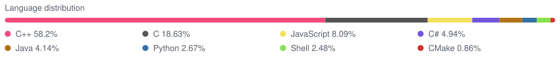

# Amadéo Héaulme

I'm a computer-engineering student at EPITA, currently a C++ software-engineering intern at ESA. I'm interested in C++, systems, performance, and machine-learning internals.

Projects:

- **SBAS Teacher NG** (07/26 – 12/26) — a cross-platform C++20 application for decoding, validating, interpreting, and exporting SBAS navigation messages, with a Qt GUI and CLI. Developed during my ESA internship; source code is currently private.
- **[Aurora](https://github.com/bymedeu/aurora)** (06/26 – present) — an early-stage learning project exploring machine learning from first principles. My current focus is M3: a scalar automatic-differentiation engine.
- **[MyStarCeiling](https://github.com/bymedeu/mystarceiling)** (07/26 – present) — an early-stage C++ astronomy engine with a working fixed-sky demonstration using real stellar catalogues.

  
   
  Language distribution across matching commits.

  

